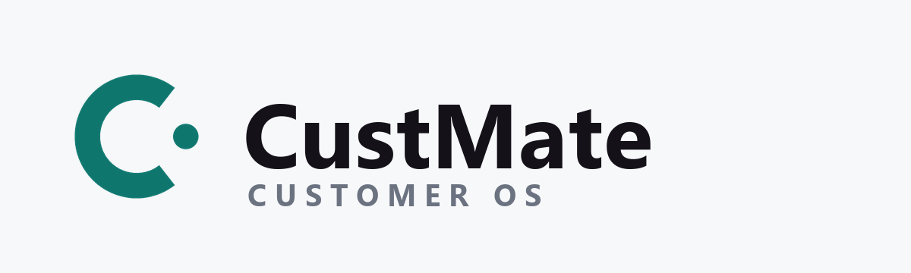
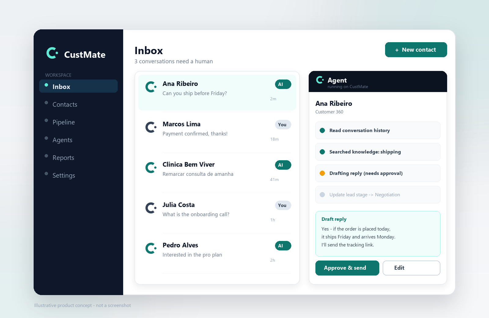

<p align="center">
  
</p>

<h1 align="center">CustMate</h1>

<p align="center">
  <strong>为 AI Agent 而生的开源客户经营系统（Customer OS）。</strong><br>
  以真实 CRM 为状态空间，让 Agent 读取客户与商机、消费知识与记忆、调用工具把业务真正推进。
</p>

<p align="center">
  <a href="#这是什么"><strong>这是什么</strong></a> ·
  <a href="#核心能力"><strong>核心能力</strong></a> ·
  <a href="#工作原理"><strong>工作原理</strong></a> ·
  <a href="#快速开始"><strong>快速开始</strong></a> ·
  <a href="#目录结构"><strong>目录结构</strong></a> ·
  <a href="#文档"><strong>文档</strong></a>
</p>

<p align="center">
  
  
  
  
  
</p>

<p align="center">
  
</p>

---

## 这是什么

大多数 CRM 只是「一个数据库加一张表单」，AI 版本再在表单旁边挂个聊天框。两者都把真正的工作——弄清楚事实、再把它写下来——留给了没空的人。

CustMate 反过来做。**Agent 不是 CRM 的一个功能；CRM 是 Agent 记录工作的地方。** 它读取联系人、会话、商机、跟进任务与知识库，按自然语言目标拆解任务、查找证据、调用工具、观察结果，再决定下一步。人则看清楚它做了什么、依据是什么，以及 CRM 发生了哪些变化。

CRM 保存业务事实，Agent 驱动行动，Harness 管理执行边界。

## 核心能力

### Agent 工作台

- 以任务和 CRM 对象为入口，支持只读调查与行动两种模式。
- 在同一条时间线上查看上下文、决策、工具调用、Observation 和状态变化。
- 查看模型绑定、Token 用量、工具次数、预算与终止原因。
- 通过持久化事件与 SSE 续读，在刷新后回放执行过程。

### 四个内置 Agent

| Agent | 职责 |
| --- | --- |
| CRM 情报员 | 汇总客户、历史会话、商机、知识与记忆，形成带证据的客户画像 |
| 销售运营 Agent | 排查停滞商机、更新字段、调整阶段、安排后续跟进 |
| 客户沟通 Agent | 结合会话和知识起草回复，核对承诺依据，提出转人工动作 |
| CRM 主管 Agent | 跨漏斗、任务和执行记录调查异常，组织专职 Agent 协作并汇总结果 |

组织预装内置 Agent，并提供可直接选择的场景任务。内置原件保持锁定，通过「复制并定制」创建自己的 Agent。

### 受控执行 Harness

- Agent 的 CRM 读写经过工具端口，权限、组织作用域和目标范围贯穿执行。
- 按读取、可逆写入、外部动作和不可逆动作分类管理工具。
- 自动执行读取与具备业务补偿能力的写入，对外动作通过人工确认。
- 保存字段差异、审计记录和撤销动作，把批准后的工具结果带回后续执行。
- 支持暂停、恢复、取消、执行租约、重试和累计预算控制。

### 多 Agent 与商机 Mission

- 主管 Agent 组织只读专职 Agent 调查，使用父子 Run 保存各自的上下文与结果。
- 独立调查支持并行执行，父 Run 统一管理业务写入和预算。
- 商机 Mission 保存目标、验收条件、截止时间和跨运行进度。
- 将客户回复、内部协作回复和负责人补充方向接入任务续跑。

### 知识与记忆

- 本地 RAG 与 WeKnora Wiki 检索接口，为回答提供知识来源、页面版本与引用。
- 联系人事实经人工确认后进入 CRM 记忆，供后续会话和任务消费。
- Mem0 接入检索排序、记忆同步、删除与清理回执。
- 组织记忆、客户记忆、知识材料和运行历史分层管理，SQL 保持业务事实源。

### Eval 与可观测性

- 围绕任务结果、证据、工具可靠性、策略遵守和记忆覆盖进行评测。
- 结合确定性检查、真实模型语义评审与回归样例，保存评分依据。
- Langfuse 接收模型与工具边界的 Trace、用量和 Eval 分数。
- 在工作台回看真实模型录制、工具调用及评测结果，复用脱敏验证样例。

## 工作原理

```text
自然语言任务 + CRM 对象
          │
          ▼
上下文构建：CRM · Wiki · Memory · Skills · 历史 Run
          │
          ▼
Pi Agent Loop ◄────────────── 工具结果 / 人工确认
          │                              ▲
          ▼                              │
Harness：权限 · 范围 · 策略 · 预算 · 审批 · 恢复
          │                              │
          ▼                              │
CRM 工具端口 ───────► 业务操作 ───────► Observation
          │
          ▼
CRM 状态变化 + Run Events + Trace + Eval
```

CRM 产品层通过自有接口调用运行内核；CRM 数据库保存业务事实，Run、事件与检查点保存执行状态。知识和记忆提供依据，工具负责动作，评测负责反馈。

## 灵活集成

- **模型**：组织级真实凭据、默认模型绑定、固定模型版本，以及 OpenAI、Anthropic、Google 和兼容模型接口。
- **Memory**：Mem0 客户记忆适配器，与 CRM 确认事实、同步队列和生命周期管理衔接。
- **LLM Wiki**：WeKnora 知识检索与来源接口，与本地 RAG、组织知识权限衔接。
- **Trace / Eval**：Langfuse 项目绑定、OTLP Trace 和评测分数投递。
- **WhatsApp**：WAHA 会话与消息工具，将客户沟通纳入审批和审计。
- **飞书内部协作**：企业身份映射、成员绑定、消息队列、回复关联与任务续跑接口。

第三方服务按组织绑定和启用，接入配置由服务端管理。模型凭据与服务凭据在服务端保管，不写入运行事件或提交记录。

## 快速开始

### 本地开发

准备 Node.js 22+、pnpm，以及开发用 Supabase 和 Redis 配置。

```bash
git clone https://github.com/indexgin/CustMate.git
cd CustMate
pnpm install --frozen-lockfile

# 仅在配置文件不存在时创建，保留已有配置
test -e .env.local || cp .env.example .env.local
test -e .env || touch .env
```

按照[开发配置指南](docs/SETUP.md)填写 Supabase、Redis、应用地址及服务端加密配置；新开发数据库按指南初始化，已有数据库按迁移流程更新。

在不同终端中启动：

```bash
# Web
pnpm dev --port 3000

# Agent 执行进程
pnpm worker

# 本地辅助调度
pnpm dev:crons
```

打开 [本地工作台](http://localhost:3000/app/ai/workbench)，登录后在组织模型配置页绑定真实模型凭据，选择内置 Agent、CRM 对象和任务开始运行。

Mem0、WeKnora 与 Langfuse 的本地服务部署和组织绑定，见[本地服务指南](infra/local-agent-services/README.md)与[接入契约](docs/integrations/agent-services.md)。

### 常用命令

| 命令 | 用途 |
| --- | --- |
| `pnpm dev` | 启动开发 Web 服务 |
| `pnpm worker` | 启动 Agent 执行进程 |
| `pnpm dev:crons` | 启动本地辅助调度 |
| `pnpm ai:agents:ensure-builtins` | 为已有组织幂等补齐内置 Agent |
| `pnpm typecheck` | 类型检查 |
| `pnpm lint` | 代码检查 |
| `pnpm test:unit` | 单元测试 |
| `pnpm test:db` | 数据库不变量与隔离检查 |
| `pnpm test:e2e` | 浏览器测试 |
| `pnpm build` | 构建应用 |

## 品牌与自托管

CustMate 是一个可自托管的开源项目，一套 Docker 镜像即可服务多个品牌。安装向导会询问你要显示的名称标识；部署后也可以在 **设置 › 品牌** 里替换名称、Logo 与主色，无需重新构建。默认使用沉稳的中性界面，身份色用在品牌标记上。

安装到自己的 VPS（含 HostGator 一键向导、域名、Supabase、WhatsApp 连接与更新），请读[自托管安装指南](docs/runbooks/deploy.md)与[品牌（white-label）说明](docs/white-label.md)。

## 项目状态

当前为内部研发版本，主分支围绕 Agent 工作台、受控 CRM 工具、多 Agent 协作、商机 Mission、知识记忆和 Eval 持续迭代。

- **真实运行记录**：已沉淀真实模型、多 Agent、Mem0 / WeKnora / Langfuse 联调与脱敏回放。
- **系统复验记录**：完成单元测试、数据库不变量、关键浏览器场景及真实模型复验。
- **工程复核记录**：类型检查、lint、构建与全量单测通过。

执行记录用于证明实际链路，业务结果由证据与验收条件核验；详细测量范围保存在对应报告中。

## 目录结构

基于 Next.js、React、TypeScript、Tailwind CSS、Supabase、Pi Agent Core / Pi AI，以及 Vitest、Playwright 构建。

| 目录 | 内容 |
| --- | --- |
| `app` / `components` | CRM 页面、Agent 工作台与产品 API |
| `lib` | CRM 领域逻辑、工具、Harness、知识记忆与服务适配器 |
| `workers` | 后台 Agent 执行 |
| `supabase` | 数据库基线、迁移与权限规则 |
| `infra` | 服务部署与接入配置 |
| `tests` | 单元、数据库与浏览器测试 |
| `examples` | 演示场景与回放入口 |
| `docs` | 架构、规格、配置与验证记录 |
| `evidence` | 文档引用的验证证据 |

本地输出放在 `output`、`tmp` 或 `scratchpad`；历史交接放在文档目录。环境文件、真实凭据、客户数据和数据库备份不进入版本库。

## 文档

- [文档入口](docs/index.md)
- [架构总览](docs/architecture/README.md)
- [开发配置](docs/SETUP.md)
- [品牌与自托管](docs/white-label.md)
- [商机 Mission 与执行状态](docs/architecture/mission-state.md)
- [飞书内部协作接口](docs/architecture/internal-collaboration-feishu.md)
- [Memory、Wiki 与 Langfuse 接入](docs/integrations/agent-services.md)
- [本地服务启动与联调](infra/local-agent-services/README.md)
- [专项 E2E 测试入口](tests/e2e/configs/README.md)

仓库内还附带一组给 AI 助手的操作指南（`pi-native-instalar`、`pi-native-cliente-novo`、`pi-native-metricas`、`pi-native-prompt`、`pi-native-contribuir`、`pi-native-doutrina`），在这些助手里直接描述任务即可自动加载。开始贡献前请阅读 [CONTRIBUTING.md](CONTRIBUTING.md)、[AGENTS.md](AGENTS.md)与[CLAUDE.md](CLAUDE.md)。

## 许可证与来源

本项目以 [MIT 许可证](LICENSE) 发布。

CustMate 是在开源项目 `pi-native-crm`（原作者 Rafael Melgaço，MIT）基础上的改名与再设计版本。按 MIT 条款，原始版权声明保留在 [LICENSE](LICENSE) 中；本次重命名与界面重设计由 CustMate 维护者完成。
